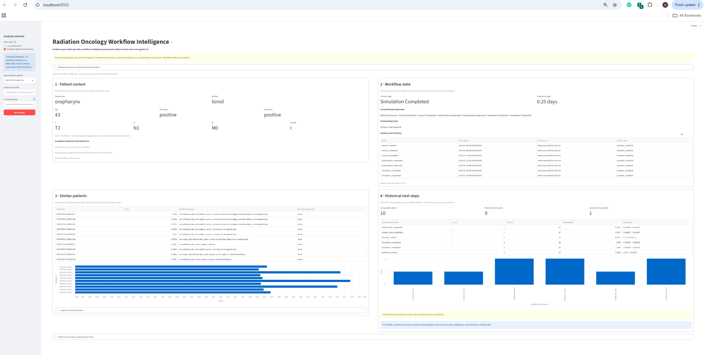
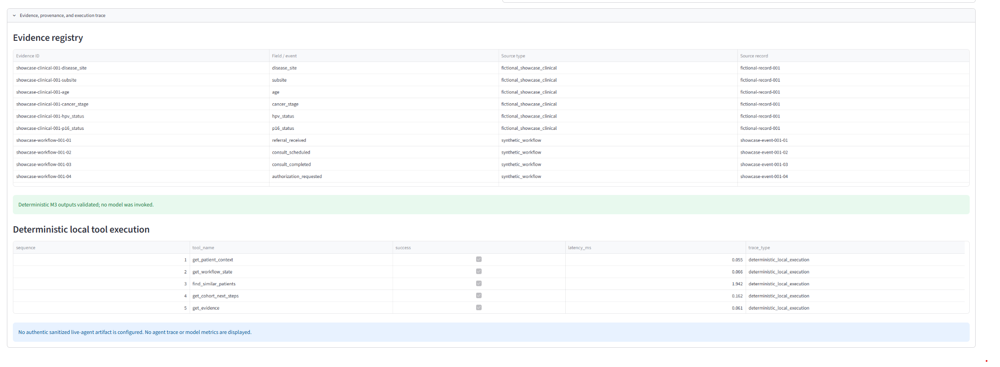
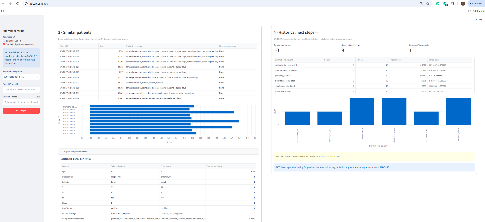
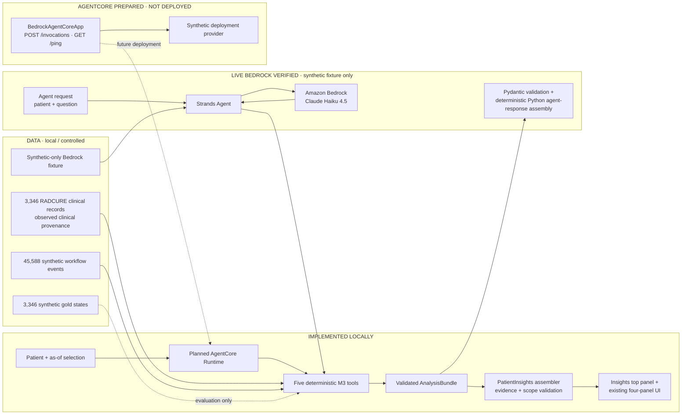

# Radiation Oncology Workflow Intelligence

## Evidence-Grounded Agentic AI for Radiation Oncology Operational Workflows

Radiation oncology delivery depends on a long sequence of handoffs—from referral and
consultation through authorization, simulation, contouring, planning, and treatment
start. The relevant context is often fragmented across records and operational systems,
making it difficult to answer a deceptively simple question: **what is happening with
this patient’s workflow now, and what evidence supports that answer?**

This prototype demonstrates a specialty workflow-intelligence layer that combines
longitudinal context, point-in-time state reconstruction, explainable retrieval, and
descriptive cohort analytics. Agentic AI is useful here as an orchestration and
narrative layer: a Strands agent can decide which bounded tools to call and synthesize
an operational answer, while deterministic Python functions remain the source of
truth for state, similarity, statistics, and evidence. The model cannot overwrite
those computed values.

### Product capabilities

| Capability | Demonstrated behavior |
| --- | --- |
| Longitudinal patient context | Presents available observed clinical attributes with field-level provenance and explicit missingness. |
| Current operational workflow state | Reconstructs the synthetic workflow only from events visible at the selected `as_of` timestamp. |
| Explainable similar-patient retrieval | Returns deterministic top-k matches with score components, missing-feature handling, and no self-match. |
| Descriptive historical next-step analytics | Summarizes synthetic next events, timing, and censoring for the retrieved cohort without making a prediction. |

### Clinician-Facing Patient Insights

The primary Streamlit view now begins with a concise **Radiation Oncology Patient
Insights** panel above the existing four detailed panels. It answers what is available
in the clinical record, where the synthetic workflow is at the selected point in time,
which documented synthetic workflow items require review, what comparable synthetic
histories demonstrated, and which evidence supports each statement.

The implementation is deterministic. The existing `run_analysis()` path invokes the
same five M3 tools exactly once—patient context, workflow state, similar patients,
cohort next steps, and evidence—and returns a validated bundle. A strict Pydantic
assembler then:

- preserves available disease, stage, HPV/p16, age, and retrospective treatment
  attributes without filling missing values;
- copies workflow stage, elapsed time, completed prerequisites, and outstanding tasks
  exactly from the point-in-time M3 result;
- preserves M3 similarity scores, explanations, missing-feature information, cohort
  denominators, event counts, censoring, and synthetic timing notices;
- classifies every statement as direct evidence, deterministic derivation,
  descriptive cohort aggregate, or explicit missingness; and
- rejects unresolved, cross-patient, mismatched-field, or future-dated patient
  evidence.

Similarity uses the stored target/comparator snapshots maintained by M3; it is not
recomputed for an arbitrary UI `as_of` selection. Comparator cohort evidence remains
separate from the selected patient's evidence index. Synthetic frequencies are
descriptive observations—not clinical probabilities, delay-risk scores, treatment
predictions, or recommendations.

**Implemented:** deterministic Patient Insights assembly, local Streamlit
presentation, 32-patient fictional showcase support, private local-cohort support,
evidence-linked statements, stale-selection protection, and the existing separate M4
Bedrock proof.

**Not implemented:** autonomous treatment actions, prospective clinical validation,
AgentCore cloud deployment, M7B live model batch evaluation, or Bedrock narration for
the 32-patient showcase. M10A defines only a future narration interface; it performs
no model invocation and adds no automatic AWS toggle.

### AWS and implementation highlights

- **Amazon Bedrock + Claude Haiku 4.5:** one bounded, synthetic-only live Strands
  invocation completed successfully with five genuine model-driven tool calls.
- **Strands Agents:** orchestrates patient context, workflow state, similarity,
  cohort next steps, and evidence retrieval.
- **Pydantic + deterministic Python assembly:** validates scope and evidence, then
  constructs the detailed response from verified tool outputs—not model-authored
  numbers.
- **Amazon Bedrock AgentCore preparation:** a `BedrockAgentCoreApp` entrypoint and
  synthetic deployment provider are implemented locally. **No AgentCore Runtime is
  deployed.**

  
## Evaluation Results at a Glance

| **3,346** | **45,588** | **3,346 / 3,346** |
| :---: | :---: | :---: |
| RADCURE clinical records processed | Synthetic operational workflow events generated | Synthetic workflow-state agreement |
| **200 / 200** | **12 / 12** | **4.79 s** |
| Offline evaluation cases passed | Deterministic safety checks passed | One live Bedrock agent invocation |

> **Evaluation scope and limitations**
>
> - **3,346 / 3,346:** Agreement with synthetic workflow reference states generated for offline testing, not real-world clinical ground truth.
> - **200 / 200:** Deterministic offline evaluation cases, not 200 live Claude model evaluations.
> - **12 / 12:** Deterministic safety/guardrail checks, not comprehensive LLM safety validation.
> - **4.79 seconds:** End-to-end duration of one successful live AWS Bedrock invocation using Claude Haiku 4.5 and synthetic-only data; not a multi-run latency benchmark.
>
> The public Streamlit demonstration contains 32 entirely fictional patients, separate from the 3,346-record RADCURE research cohort. Operational events are synthetic. The prototype has not undergone prospective clinical validation or production clinical deployment.


### Evaluation Methodology and Performance

The evaluation combines deterministic workflow-state
reconstruction, adversarial/edge-case testing, safety
policy checks, and local tool-performance measurements.

**Offline evaluation coverage**
- 160 stratified synthetic workflow scenarios spanning
  eight operational phenotypes (20 cases per phenotype).
- 40 adversarial and edge-case scenarios.
- Workflow-state reconstruction validated against
  generator-derived synthetic references, including
  workflow stage, outstanding tasks, completed
  prerequisites, and point-in-time visible evidence.
- Deterministic clinical-safety policy fixtures evaluated
  separately from foundation-model behavior.

**Local tool latency (milliseconds)**

| Deterministic tool | p50 | p95 |
|---|---:|---:|
| Similar-patient retrieval | 69.26 | 102.82 |
| Historical cohort next steps | 63.17 | 92.69 |
| Evidence retrieval | 0.01 | 0.02 |

**Evaluation limitations**

- Synthetic workflow references are not clinical ground truth.
- The offline evaluation results do not measure Claude's
  clinical reasoning accuracy or end-to-end agent reliability.
- Live LLM batch evaluation (M7B) has not been performed;
  model-level safety performance remains unmeasured.
- Tool latencies are local deterministic measurements,
  not hosted AWS service-level latency benchmarks.
- No prospective clinical validation or production
  clinical deployment has been performed.


### Validated synthetic showcase

The screenshots below use the separate **32-patient entirely fictional showcase**.
They contain no RADCURE patient record and show deterministic local execution—not a
live Bedrock trace.

The private local research cohort remains a separate evidence base: **3,346 clinical
patient records**, **14 mapped priority clinical columns**, and **45,588 synthetic
workflow events**. Its offline framework passed **200/200 evaluation cases**. These
aggregate facts do not imply that the public showcase contains or represents those
retrospective records.

#### Four-panel overview



#### Evidence and deterministic execution



#### Similarity explanations and cohort analytics



### Architecture



The same diagram and status legend are maintained in
[`architecture/PORTFOLIO_ARCHITECTURE.md`](architecture/PORTFOLIO_ARCHITECTURE.md).

### Prototype limitations

Operational histories and dates are synthetic. Generator-derived gold states are not
clinical truth. Similarity weights are transparent prototype defaults, not clinically
validated relevance. No multi-site or prospective validation has occurred. The system
does not diagnose, select treatment, recommend radiation dose, predict toxicity or
outcomes, or take autonomous workflow action. AgentCore deployment and live LLM batch
evaluation remain future work.

## Clinical safety boundary

This prototype supports operational workflow research only. It must not diagnose,
recommend treatment or radiation dose, predict toxicity or clinical outcomes, or
make autonomous clinical decisions. Its output requires qualified human review
and must not be used as a substitute for source records or clinical judgment.

## Requirements

- Windows 11 and PowerShell
- Python 3.11 or newer
- Git

AWS credentials and external patient datasets are not required for M0.

> **Publication restriction:** publish only the reviewed orphan `main` branch, which
> has an independent root commit. Never push `master`, tags, all branches, or a mirror.
> See
> [`docs/PUBLICATION_SECURITY.md`](docs/PUBLICATION_SECURITY.md).

## Windows setup

From the repository root:

```powershell
py -3.11 -m venv .venv
.\.venv\Scripts\Activate.ps1
python -m pip install --upgrade pip
python -m pip install -e ".[dev]"
```

If the Python launcher is not registered, replace `py -3.11` with the full path
to a Python 3.11+ interpreter.

Run the quality checks:

```powershell
python -m pytest -q
python -m ruff check .
```

### Public fixture tests versus private-cohort tests

The distributable synthetic fixture and file-generated test data require no RADCURE
copy and make no AWS call:

```powershell
python -m pytest -q `
  tests/test_package.py `
  tests/test_schemas.py `
  tests/test_ingestion.py `
  tests/test_workflow_generator.py `
  tests/test_showcase.py `
  tests/test_ui.py::test_synthetic_mode_uses_fixture_and_never_calls_aws `
  tests/test_ui.py::test_streamlit_app_imports_and_starts_without_analysis `
  tests/test_ui.py::test_streamlit_synthetic_walkthrough_populates_four_panels
```

The complete suite additionally includes `test_intelligence.py`, `test_evaluation.py`,
and local-cohort cases in the agent, AgentCore, and UI tests. Those checks require the
authorized, Git-ignored `data/processed/` artifacts and therefore cannot run from a
public source snapshot alone. No test should download RADCURE automatically.

## Clinical ingestion (M1)

The ingestion command requires three explicit paths and never searches for or
downloads clinical data:

```powershell
python -m rad_intel.data_pipeline `
  --input C:\approved-local-path\radcure.csv `
  --mapping C:\approved-local-path\radcure-mapping.json `
  --output data\processed
```

CSV and XLSX inputs are supported. XLSX mappings may include `sheet_name`. The
mapping JSON names actual source headers; no real RADCURE header is assumed:

```json
{
  "source_name": "authorized-source-name",
  "sheet_name": null,
  "fields": {
    "patient_id": "replace-with-actual-ID-header",
    "disease_site": "replace-with-actual-site-header",
    "subsite": null,
    "age": "replace-with-actual-age-header",
    "cancer_stage": null,
    "hpv_status": null,
    "systemic_therapy": null,
    "radiation_treatment_characteristics": {
      "source-supported-characteristic": "replace-with-actual-header"
    }
  },
  "value_maps": {}
}
```

Only `patient_id` is required. Optional fields must remain `null` or empty unless
the source and dictionary support them. `value_maps` may explicitly normalize
supported categorical values; an unmapped value is preserved and counted rather
than guessed. Invalid ages are left missing and counted. Duplicate identifiers use
a deterministic first-record policy, with later records excluded and reported in
aggregate.

Each run writes `patients.csv`, `data_quality.json`, and `field_mapping.json` to
the chosen output directory. These patient-level/generated files are excluded from
Git. The CLI prints counts only and never logs patient identifiers or clinical
values.

### Authorized RADCURE reproduction

This repository does not redistribute RADCURE source or patient-level derivative
files. Obtain an authorized copy directly from the
[RADCURE collection at The Cancer Imaging Archive](https://www.cancerimagingarchive.net/collection/radcure/),
DOI [`10.7937/J47W-NM11`](https://doi.org/10.7937/J47W-NM11). Review the
collection’s current data-usage terms and retain it only in approved local or
restricted storage. TCIA lists the clinical spreadsheet under CC BY 4.0 and the
imaging collection under controlled-access terms; those permissions are not expanded
by this repository. Place source files under the Git-ignored `data/raw/` directory,
inspect the actual workbook version and headers, then run the explicit ingestion
command above. Never commit or redistribute `data/raw/` or `data/processed/`.

## Synthetic workflow generation (M2)

Generate deterministic synthetic operational histories from patient identifiers:

```powershell
python -m rad_intel.workflow_generator `
  --patients data\processed\patients.csv `
  --output data\processed `
  --seed 42
```

The generator reads only `patient_id`; it does not use clinical RT dates or infer
that referral, authorization, contouring, planning, or scheduling occurred. All
workflow dates begin from a synthetic UTC anchor and use configurable bounded-hour
demonstration assumptions. These assumptions are plausible for a prototype but are
not measured or claimed real-world timing distributions.

Each patient receives the 13 required baseline events in valid order and one of
eight balanced synthetic phenotypes. Rescheduling, no-show, and hospitalization
phenotypes include explicit exception events. Snapshots span multiple stages, use
only events and evidence at or before `as_of`, and keep gold references in a
separate file that must never be supplied as agent-visible input.

The command writes `workflow_events.csv`, `workflow_snapshots.csv`,
`workflow_gold.json`, and `generation_report.json`. All four outputs are excluded
from Git and are byte-identical for the same input bytes, configuration, and seed.

## Deterministic intelligence tools (M3)

`rad_intel.tools` exposes:

- `get_patient_context(patient_id)`
- `get_workflow_state(patient_id, as_of)`
- `find_similar_patients(patient_id, k=10)`
- `get_cohort_next_steps(patient_ids)`
- `get_evidence(patient_id, evidence_ids)`

The workflow tool reconstructs state only from synthetic events at or before the
requested time and never reads gold labels. Similarity uses a configurable,
missing-aware weighted Gower-style calculation over available clinical disease
features and each patient's own point-in-time operational snapshot. Retrospective
treatment fields, phenotype labels, future events, outcomes, and gold labels are
excluded from similarity.

Run the local structured-JSON demonstration with:

```powershell
python -m rad_intel.tools.demo
```

The cohort tool reports descriptive synthetic next-event frequencies and timing;
it does not predict outcomes or recommend clinical or operational action.

## Strands and Amazon Bedrock orchestration (M4)

M4 registers all five M3 functions as Strands `@tool` adapters and binds each run
to one target patient in Python. The cohort adapter accepts only the exact patient
set returned by the scoped similarity call, and evidence resolution accepts only the
target patient's identifiers. The model returns a concise ordinary text narrative;
native Strands structured output is not used. Python assembles the detailed Pydantic
JSON from the captured M3 tool results. Altered counts, unsupported values, invalid
citations, missing tool executions, and cross-patient attribution are rejected.

Configuration uses environment variables and never embeds credentials:

```powershell
$env:AWS_PROFILE = "least-privilege-development-profile"
$env:AWS_REGION = "us-east-1"
$env:BEDROCK_MODEL_ID = "us.anthropic.claude-haiku-4-5-20251001-v1:0"
```

The selected ID was discovered as a system-defined inference profile in `us-east-1`.
Claude Haiku 4.5 supports tool use and was chosen to minimize smoke-test cost. The
normal client uses bounded retries and timeouts. The live smoke command further limits
execution to eight turns, ten tool calls, 4,096 output tokens per model response,
8,000 cumulative output tokens, one total AWS attempt, and a 12,000-token aggregate
agent limit.

Run the offline demonstration with explicit patient and point-in-time arguments:

```powershell
python -m rad_intel.agent.demo `
  --patient-id <authorized-local-patient-id> `
  --as-of <timezone-aware-snapshot-time>
```

Read-only identity/model discovery is available with `--discover`. The prepared
`--live-smoke` path contains only an explicitly synthetic fixture. Root remains blocked
by default. The explicit `--allow-root-synthetic-smoke` exception fails closed unless
the built-in fixture, `rad-intel` profile, `us-east-1` region, exact selected model, and
all tighter invocation bounds match. This exception is unavailable to normal patient
or deployment paths.

The authorized synthetic live validation on 2026-11-01 completed with normal
`end_turn` output. The model genuinely invoked all five tools, and Python validated
the plain-English synthetic workflow narrative before assembling the detailed JSON.
The run used 6,231 input tokens and 595 output tokens (6,826 total) with 4,790.511 ms
agent latency. Evidence scope, deterministic numerical values, patient isolation,
synthetic provenance, and the no-treatment-recommendation boundary all passed.

## Current status

M0 provides the repository and shared contracts. M1 provides deterministic
clinical ingestion for 3,346 verified patients. M2 provides 45,588 synthetic
workflow events, 3,346 point-in-time snapshots, and independently derived gold
states with no sequence or future-information violations. M3 provides clinical
context, independent state reconstruction, auditable similarity, descriptive
next-step analytics, and patient-isolated evidence resolution. M4 provides a
live-validated Strands agent, Bedrock configuration, five scoped adapters, ordinary
model narrative validation, deterministic Python JSON assembly, and a synthetic-only
smoke path. M5A prepares a local AgentCore Runtime boundary, M6 provides the local
four-panel Streamlit demonstration, and M7A provides offline quantitative evaluation.
AgentCore deployment is not implemented. See
[`docs/IMPLEMENTATION_STATUS.md`](docs/IMPLEMENTATION_STATUS.md) for verified
status and [`docs/roadmap.md`](docs/roadmap.md) for milestone boundaries.

## AgentCore Runtime preparation (M5A)

M5A wraps the existing M4 service with the current AgentCore Python SDK. The entrypoint
is `rad_intel.agentcore_runtime.app:app`, backed by `BedrockAgentCoreApp` and its
`POST /invocations` and `GET /ping` routes. Invocation payloads use:

```json
{
  "patient_id": "...",
  "question": "...",
  "as_of": null
}
```

Remote model creation uses the AWS default credential provider chain supplied by the
future AgentCore execution role; it rejects named profiles. This does not change the
local M4 profile or root guard. `RAD_INTEL_DATA_PROVIDER=synthetic` is the safe remote
default. `local` remains available only for an explicitly selected local processed
directory and is not deployment-safe.

Prepared files, packaging boundaries, the current AgentCore CLI workflow, permissions,
cost categories, monitoring, cleanup, security limitations, and M5B blockers are
documented in [`deployment/agentcore/README.md`](deployment/agentcore/README.md) and
[`deployment/agentcore/DEPLOYMENT_READINESS.md`](deployment/agentcore/DEPLOYMENT_READINESS.md).
M5A did not run deployment commands or create AWS resources. M5B is not started.

## Four-panel Streamlit demo (M6)

Install the pinned dependencies and launch the application from Windows PowerShell:

```powershell
Set-Location <repository-path>
.\.venv\Scripts\Activate.ps1
python -m pip install -e ".[dev]"
python -m streamlit run src\rad_intel\ui\app.py
```

Open `http://localhost:8501` if the browser does not open automatically.

The application supports two explicit data modes:

- **Local Full Cohort** reads the Git-ignored local processed artifacts for all 3,346
  patients and runs only deterministic M3 intelligence. It never sends those clinical
  records to Bedrock and never labels local execution as an LLM response.
- **Synthetic Agent Demonstration** loads a built-in cohort of 32 entirely fictional
  patient contexts and synthetic workflow histories. It does not read RADCURE files
  or invoke AWS automatically. A recorded live-agent trace is shown only when
  `RAD_INTEL_RECORDED_AGENT_ARTIFACT` points to an authentic sanitized M4 JSON artifact
  that passes schema, evidence, patient-scope, numerical, and execution validation.

The four panels display observed clinical context, point-in-time synthetic workflow
state, deterministic top-10 similarity, and descriptive synthetic next-step statistics.
An evidence expander exposes references, provenance, the genuine local tool sequence,
and validated recorded model metrics when available. Future workflow events are not
shown as completed at the selected timestamp.

This remains a research demonstration. Treatment attributes may be retrospective and
their availability at earlier workflow stages is not established. Synthetic workflow
events and cohort timing are not observed clinical operations or outcomes. The UI must
not be used for diagnosis, treatment selection, outcome prediction, or autonomous
clinical decisions.

### Fictional showcase cohort (M6.1)

The distributable showcase cohort is intentionally separate from the one-record M4
Bedrock smoke fixture and from all private local cohort files. It contains 32 fictional
records with linked clinical evidence, complete synthetic workflow histories, varied
point-in-time snapshots, resolved no-show and hospitalization events, and at least ten
usable comparators. The existing missing-aware weighted Gower implementation computes
similarity scores, feature comparisons, and reasons; synthetic next-event counts and
timing summaries are derived from each comparator's future events rather than authored
as display values.

Showcase stage groups use the **AJCC 8th edition clinical prognostic** convention. The
fixture explicitly records fictional p16 status for oropharyngeal records and derives
each supported overall stage from site, p16, T, N, and M. For example, fictional
p16-positive oropharyngeal T2 N1 M0 is Stage I—not Stage II. Unsupported combinations
fail fixture construction instead of accepting an independently authored stage. The
rules follow the [NCI AJCC 8 oropharyngeal stage tables](https://www.cancer.gov/types/head-and-neck/hp/adult/oropharyngeal-treatment-pdq);
larynx, hypopharynx, and oral-cavity combinations use the corresponding NCI AJCC 8
tables. These fictional combinations are not clinical advice or a validation dataset.
The top-ten comparison-factor expander renders the exact M3 query, comparator, and
per-feature similarity values as readable tables without recalculation.

The full local mode remains unchanged: 3,346 RADCURE clinical records with 14 mapped
priority columns are paired with 3,346 synthetic workflow histories and 45,588 synthetic
events. Those patient-level artifacts remain local and Git-ignored. The public showcase
is not sampled from, calibrated to, or claimed representative of RADCURE or real-world
radiation-oncology operations. A deterministic local execution trace is not labeled as
a live agent run.

The three authentic updated M6.1 screenshots above passed synthetic-data and
sensitive-content review. No screenshot or live-agent trace was fabricated.

## Offline quantitative evaluation (M7A)

Run the deterministic framework without AWS or Bedrock:

```powershell
python -m evaluation.runner `
  --data-directory data\processed `
  --output evaluation\results
```

M7A uses 200 fixed-seed cases: 160 stage-diverse cases across all eight synthetic
workflow phenotypes and 40 adversarial or edge cases. It also reconstructs every one
of the 3,346 synthetic gold snapshots and checks workflow stage, outstanding tasks,
prerequisites, evidence, and future-information boundaries. Similarity checks are
behavioral software invariants and are not a clinical validation claim.

Committed results are aggregate and sanitized. Patient identifiers and clinical
values are never written to evaluation reports. Agent metrics remain `NOT_MEASURED`
unless an explicitly supplied sanitized M4 artifact is validated; the live batch
runner is disabled. See
[`docs/EVALUATION_METHODOLOGY.md`](docs/EVALUATION_METHODOLOGY.md) for details.
