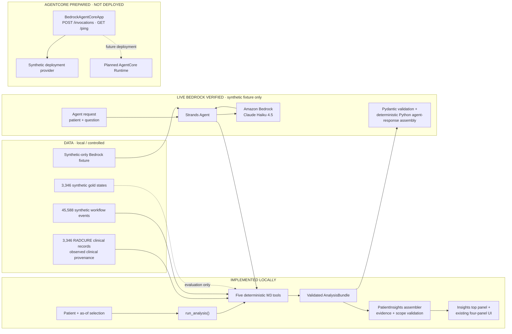

# Portfolio architecture

## Status legend

- **Implemented locally:** data ingestion, synthetic workflow generation, five
  deterministic intelligence tools, validated Patient Insights assembly, evaluation,
  and the Streamlit insights plus four-panel UI.
- **Live Bedrock verified:** exactly one bounded synthetic-fixture Strands invocation.
- **AgentCore prepared but not deployed:** compatible app entrypoint, providers,
  packaging, readiness analysis, and local tests exist; no cloud runtime exists.

Observed clinical data and synthetic workflow data remain separate. Gold labels are
evaluation-only and are not visible to production intelligence tools or the agent.
